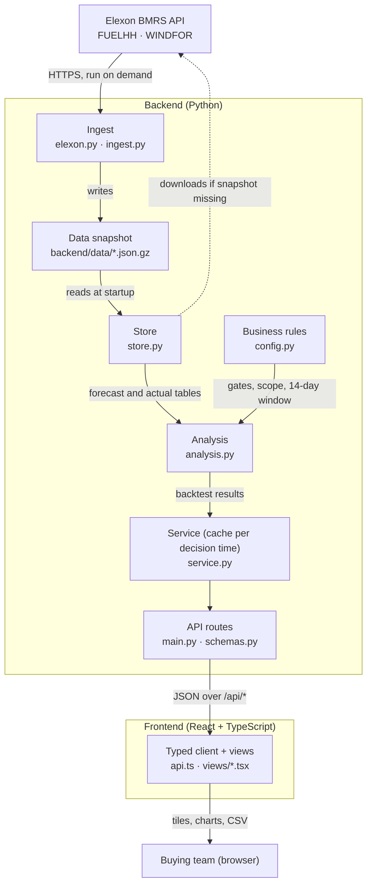
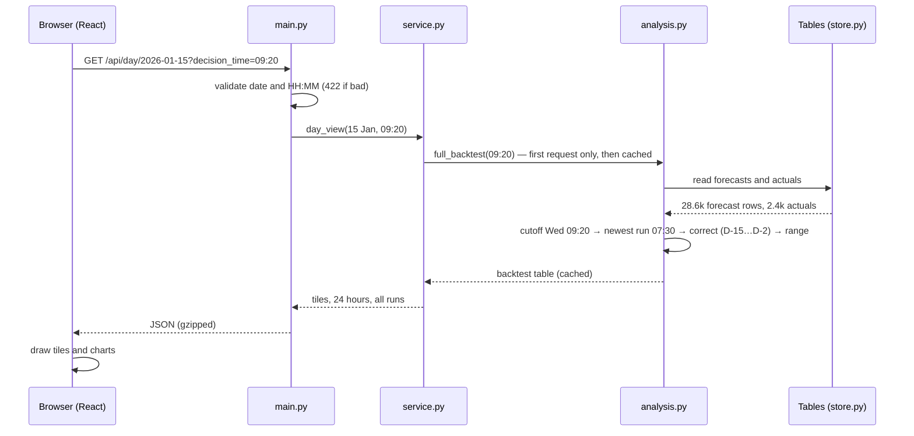

# Architecture and design notes

Written for the technical reviewer. It covers how the system fits together, why it is built this way, and what to check.

## 1. System overview

What happens when someone opens a delivery day (here 15 Jan at the 09:20 gate):

Deployment shapes, all from the same code:

- **Docker / Heroku:** one container. uvicorn serves the API and the built React files in `static/`.
- **Vercel:** static React build from `frontend/dist`, plus a Python serverless function (`api/index.py`) for `/api/*`.
- **Dev:** Vite on :5173 proxies `/api` to uvicorn on :8000.

## 2. Data

| Dataset | Endpoint | Use | Notes |
|---|---|---|---|
| FUELHH | `/datasets/FUELHH/stream?fuelType=WIND` | Actuals | Half-hourly MW, `startTime` UTC |
| WINDFOR | `/datasets/WINDFOR/stream` | Forecasts | Hourly targets, about 8 runs/day (02:30, 04:30, 07:30, 09:30, 11:30, 15:30, 18:30, 22:30 UTC), horizon to D+2 21:00 UTC |

**Snapshot, not live calls.** January 2026 is history. The raw rows are stored gzipped in the repo (about 165 KB) and turned into DataFrames at startup. This means:

- cold start in milliseconds, which matters on serverless;
- no dependence on Elexon being up during a demo or review;
- reproducible numbers (the snapshot is versioned in git).

`python -m app.ingest` rebuilds it. If the files are missing, `store.load()` downloads from Elexon automatically.

**Window.** Publish times from 15 Dec 2025 to the end of 1 Feb 2026. The December data is used only to warm up calibration for early-January decisions. It is the history a trader would have had on 1 January.

**Hourly alignment.** WINDFOR is hourly. The two FUELHH half-hours in each hour are averaged, and an hour with a missing half-hour is dropped rather than half-filled. Hourly also matches the day-ahead auction products.

## 3. Core domain rules (analysis.py)

1. **Delivery day vs decision day.** Decisions made in January 2026 cover delivery days 2 Jan – 1 Feb 2026 (`scope_delivery_days`).
2. **Decision cutoff.** D-1 at the chosen UK local time, converted to UTC with `zoneinfo`, so it works across BST changes (`decision_cutoff`). Delivery days have 23, 24 or 25 hours (`delivery_hours`).
3. **Latest forecast at cutoff.** `pd.merge_asof(..., by="start_time", direction="backward")` on `publish_time ≤ cutoff`. It never looks ahead. A forecast published exactly at the cutoff counts.
4. **Error convention.** `actual − forecast`. Negative means wind shortfall, so the buyer is short.
5. **Calibration and range, out of sample.** For delivery day D the window is delivery days [D-15, D-2]. D-1 is not settled at 09:20 on D-1. The correction is wind-level-aware, because the over-forecast grows with forecast level:
   - `fit_correction`: least-squares line `actual ≈ intercept + slope × forecast` on the window (falls back to Σactual/Σforecast if the forecast barely varies or the slope isn't positive)
   - `apply_correction`: `calibrated = clip(min(intercept + slope × forecast, forecast), 0)`, so it only removes over-forecast and never adds wind Elexon didn't predict
   - `range = calibrated × [P10, P90] of hourly actual/calibrated in the window` (hours below 1 GW excluded)
   - requires at least 48 hours of history, otherwise NaN
6. **Metrics.** MAE, RMSE, bias, nMAE (MAE ÷ mean actual), P50/P90 absolute error, max shortfall/surplus, range coverage and width.
7. **Diagnostics.**
   - *Lead-time profile:* every run, every target hour in scope, bucketed by `start − publish` in 6 h bins. Negative leads (backcasts) are excluded.
   - *Decision-time sensitivity:* the backtest re-run for decision times every 30 min across D-1.

## 4. API design

- Thin routes (`main.py`), shaping and caching (`service.py`), and pure maths (`analysis.py`) are kept separate, so the maths can be tested without HTTP.
- Validation is done at the edge: a regex for `HH:MM` and a range check for the date. Bad input returns 422 with a clear message.
- Pydantic response models give typed, self-documenting OpenAPI docs at `/api/docs`. The frontend's `api.ts` mirrors them.
- `lru_cache` per decision time: a backtest is about 30 ms, and the full 48-point sensitivity curve is cached by date range.
- GZip middleware: the day payload with all runs is about 60 KB raw.

## 5. Frontend design

- **Two jobs, two views.** *Day-ahead* covers the decision: what we knew, how much to cover. *Forecast accuracy* covers trust: how good the forecast is and where it fails. *Method* explains the definitions for auditability.
- **Decision time is global.** It sits in the header. Switching EPEX/N2EX/custom re-runs everything.
- **URL holds state** (`?view=day&day=2026-01-15&t=09:20`), so any view can be linked or bookmarked.
- **Hindsight is labelled.** Actuals are visually separated (grey "Hindsight" tile, toggleable line), so the decision view stays honest about what was knowable.
- **Charts.** One y-axis per chart, no dual axes. Colour by role: Elexon = orange, calibrated = blue, actual = ink, shortfall = red. Legends toggle series, tooltips show exact values, and CSV export is provided. Light and dark themes come from CSS tokens.
- **Stale-while-loading:** the previous result fades while a new one loads, so the page doesn't flash.

## 6. Testing

- `tests/test_analysis.py`: synthetic-data unit tests for the rules above. Covers DST days, no-look-ahead, exact-cutoff inclusion, NaN for missing hours, error sign, calibration learning, **no-leak of D-1/D into calibration**, metric arithmetic, histogram completeness and backcast exclusion.
- `tests/test_api.py`: endpoints against the real snapshot. Checks gate-closure run selection (09:20 picks the 07:30 run; 09:50 picks the 09:30 run), range ordering, coverage in a sane range, and input validation.
- `frontend/src/format.test.ts`: units, ticks and CSV quoting.
- CI (`.github/workflows/ci.yml`): ruff lint and format, pytest, tsc, vitest, Vite build, Docker build and smoke test.

## 7. Trade-offs and next steps

| Decision | Why | Revisit when |
|---|---|---|
| Snapshot in git | Reliability, speed, reproducibility for a fixed historical scope | Going live: scheduled ingest into a DB (Postgres/Timescale) |
| pandas in request path | Small data (about 30k rows), clear code | Larger scope: precompute backtests in a job |
| Capped linear calibration | Explainable to traders, out-of-sample, −40% MAE, tighter range than a scale factor, same number of losing days | More history, curtailment signals, quantile regression for the range |
| Hourly resolution | Matches WINDFOR and DA hourly products | Half-hourly products, which would need forecast interpolation |
| Error band from empirical ratios | No distribution assumptions, verified coverage | Conditional bands by forecast level or hour |

Possible next steps:

- add demand to show residual (net) position;
- alerting when the range is unusually wide;
- add other renewables (solar, embedded wind);
- authentication and an audit log of decisions.
